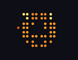

# claude-statusline

A colourful, animated status line for Claude Code.


```
⠰⡄⢈⠛⠰⡄ ⏱ 1h01m │ ✦ claude 2m05s │ 5h 62% ↻ 1h30m
user@host /path/to/dir │ ◆ Sonnet │ ctx 12%
```

- **Line 1:** matrix-rain animation, session time, Claude API time, 5h rate-limit usage and time until it resets.
- **Line 2:** user@host, directory, model, context usage.
- Percentages are green < 50%, yellow < 80%, red above. "claude" is Claude orange.
- The 5h number only appears when Claude Code reports rate limits (subscription plans).

## Cheat sheet

Run these in any normal terminal, from any folder. Inside Claude Code you can also type them after a `!`
(e.g. `! echo snake > ~/.claude/statusline-profile`), except `lava-demo`, which loops forever and needs its own terminal.
Switching the look takes effect within a second, no restart.

```bash
# on
git clone https://github.com/xhanAI/claude-statusline.git ~/repos/active/claude-statusline
cd ~/repos/active/claude-statusline && ./install.sh     # needs jq; restart Claude Code

# pick a look
echo xhanAI  > ~/.claude/statusline-profile   # lava (or any effect: acid tunnel snake hourglass ...)
echo default > ~/.claude/statusline-profile   # simplest, 2 lines
echo max     > ~/.claude/statusline-profile   # everything, 4 lines
# animations (xhanAI layout): lava acid tunnel aurora ember warp pulse helix ripple ecg hourglass life snake ultra planet
echo snake   > ~/.claude/statusline-profile

# preview the animations (own terminal, Ctrl+C to stop)
lava-demo all          # every animation in every mood
lava-demo snake        # just one
claude-cost            # money spent per repo; claude-cost . for this repo's sessions

# update
cd ~/repos/active/claude-statusline && git pull && ./install.sh

# off (back to Claude Code's own bar)
jq 'del(.statusLine)' ~/.claude/settings.json > /tmp/s.json && mv /tmp/s.json ~/.claude/settings.json
```

## Install

Needs `jq`.

```bash
git clone <this repo> && cd claude-statusline && ./install.sh
```

This copies the script to `~/.claude/`, sets `statusLine` in `~/.claude/settings.json` (backup saved as `settings.json.bak`) with `refreshInterval: 1` so the animation ticks.

## Profiles

```bash
echo default > ~/.claude/statusline-profile   # the 2-line bar above
echo max     > ~/.claude/statusline-profile   # everything, 4 lines
echo xhanAI  > ~/.claude/statusline-profile   # minimal, 3 lines, lava lamp
echo acid    > ~/.claude/statusline-profile   # xhanAI layout with another effect (see "Effects")
```

The **max** profile:

```
⠃⠶⡄⢈⠃⠰ Session name in a gradient │ ◆ Opus 5.5 effort medium 🧠 │ Tue 21:53 v2.1.296
⏱ 12m11s │ ✦ claude 2m30s 20% busy │ $0.97 $4.75/h │ +120 −30
5h 48% ↻ 2h16m │ 7d 26% ↻ 6d10h │ ctx 8% 78k/1.0M │ ♨ cache 94% warm 58m
user@host ~/repos/x ⎇ main ● 3 ↑1 │ cpu 4% ram 49% 38°C │ 🌦️ 13°C
```

- Session name, model, effort, thinking / fast mode, output style, ticking clock (the colon blinks), Claude Code version.
- Session time, Claude time and % of the session Claude was busy, cost and hourly burn rate, lines added/removed.
- 5h and 7d limits with reset countdowns, context % with tokens, prompt-cache hit rate and how long it stays warm.
- Past 90% of the 5h limit the rain turns red and a blinking `⚠ SLOW DOWN` appears.
- Git branch, dirty file count (or ✔), ahead/behind; CPU load, RAM, CPU temperature; weather from wttr.in (cached 30 min, fetched in the background).

The **xhanAI** profile: minimal, with a tiny lava lamp on the left:

```
▀▀▀▀▀▀▀▀  ~/repos/active/claude-statusline on main ● 3  ↑ 1 synced 12m ago
▀▀▀▀▀▀▀▀  opus 5.5 med   🌦️ 13°C   v2.1.296
▀▀▀▀▀▀▀▀  12m11s ✦ 2m30s   $0.97 4.75/h Σ $19.52   5h 48% 2h06m   ctx 8%   +152 −51
```

After the branch: `● 3` changed files, then the remote: `↑ 2` commits not pushed, `↓ 1` commits to pull
(as of the last fetch), `✓` in sync, `no remote` if the branch was never pushed, and `synced 12m ago`,
the last fetch, pull or push. The status line never fetches by itself; run `git fetch` to refresh ↓.
If the session has moved away from the folder Claude Code was started in, the line ends with `started in ~/x`.

The path and branch get a line to themselves so their changing length never shifts anything else.
Line 2 is the model + effort, weather and version; line 3 is the numbers
(session time, Claude time, cost + hourly rate + project total, 5h limit + time to reset, context, lines changed).

### The lava

Each `▀` has its own top (foreground) and bottom (background) colour, so the 8x3 block is an
8x6 true-colour canvas. A plasma of overlapping sine waves flows through it; the mood sets palette and speed:

| mood | looks like | when |
|---|---|---|
| calm | slow orange lava | default |
| working | electric cyan, fast | the transcript was written in the last 4 s (Claude is busy) |
| fire | magenta to white, fastest | working and burning more than $15/h |
| idle | deep blue with a crescent moon, very slow | prompt cache went cold (you've been away) |
| warn | hazard yellow | 5h limit or context at 70%+ |
| alarm | red, pulsing | 5h limit or context at 90%+ |
| clean | green flash for 6 s | the git tree just went from dirty to clean (you committed) |

Run `lava-demo` to watch every mood at 15 fps. `echo rain > ~/.claude/statusline-art` brings back the matrix rain.
Cost: ~30 ms per refresh (one `jq`, one `awk` for the lava).

### Effects

The same canvas can draw other things, borrowed from the badtrippin experiments. Each is a profile name
(`echo tunnel > ~/.claude/statusline-profile`), or `echo tunnel > ~/.claude/statusline-art` under xhanAI:

| | | | |
|:-:|:-:|:-:|:-:|
| <br>`lava` | <br>`acid` | <br>`tunnel` | <br>`aurora` |
| <br>`ember` | <br>`warp` | <br>`pulse` | <br>`helix` |
| <br>`ripple` | <br>`ecg` | <br>`hourglass` | <br>`life` |
| <br>`snake` | <br>`rain` | <br>`ultra` | <br>`planet` |

The live bar redraws once a second; the GIFs are smoother (12 fps). Regenerate them with `tools/make-gifs.py`.

| effect | what it is |
|---|---|
| lava | the lava lamp above (default) |
| acid | rainbow plasma: six sine waves run through HSV, like badtrippin's `me.py` |
| tunnel | a spiral tunnel rushing at you |
| aurora | northern lights curtains over a twinkling sky |
| ember | doom-style fire licking up from the bottom |
| warp | stars flying past |
| pulse | an equalizer; bars jump higher the harder Claude works |
| helix | a spinning DNA double helix, on a see-through background (your terminal shows through) |
| ripple | raindrops falling on water |
| ecg | a heartbeat monitor; the pulse races while Claude works |
| hourglass | the sand that has run through = how much of the 5h limit is used |
| life | Conway's game of life, a new world every 30 s |
| snake | a snake touring the canvas, longer as the context fills up |
| ultra | strokes only: a wireframe armillary sphere with an orbiting moon, see-through (braille, 16x12 dots) |
| planet | a lit, turning lava planet with an atmosphere, in a see-through sky (sextants, see below) |
| rain | the 3-row matrix rain |

The effects keep their own colours and wear the mood on top: busy makes them faster and brighter,
idle dims and slows them, warn tints amber, alarm pulses red, clean flashes green.
**ultra** and **planet** push the canvas as far as a status line goes. Claude Code refreshes it at most once a second
(`refreshInterval` minimum is 1, events are debounced at 300 ms), so frame rate can't go up; detail can.
`ultra` draws strokes with braille: 2x4 square dots per character, 16x12 in all, and empty dots let the
terminal show through. `planet` fills instead, with Unicode *sextants* (U+1FB00), 2x3 solid pixels per character instead of the 1x2 of `▀`:
16x9 pixels in the same 8x3 space, each one averaged from 4 samples, and each cell gets the two colours
that best fit its six pixels. The planet's surface wears the lava's mood colours.
Sextants are drawn natively by VTE terminals (GNOME Terminal, Ptyxis, Tilix), kitty, WezTerm, foot and
Windows Terminal; elsewhere you need a font with the Legacy Computing block (Cascadia, Iosevka), or you'll see boxes.

`lava-demo tunnel` shows one effect through every mood; `lava-demo all` cycles through all of them.

## Project cost over time

The status line keeps a tiny file per session in `~/.claude/cost-ledger/<session-id>`, written only
when the cost changes. A project is the **git repo you are in** (or the directory, outside a repo), and
every increase in the session cost is charged to wherever the session is when it happens. So one
session started in `~` that works in three repos charges each repo its own share. If a resumed session
restarts its counter, it counts on from zero and nothing is lost.

- The xhanAI profile shows the project's all-time total next to the session cost: `$0.97 4.75/h Σ $23.10`.
- `claude-cost` lists every project, most expensive first; `claude-cost <dir>` lists that project's sessions.

Only sessions run with this status line are counted; earlier ones aren't in the ledger. Before
2026-10-13 everything was charged to the directory Claude Code was started in, so those totals sit there.

## Rain style

```bash
echo dots    > ~/.claude/statusline-rain   # braille dots (default)
echo letters > ~/.claude/statusline-rain   # katakana, very trippy
```

## How it works

Claude Code pipes a JSON blob (cwd, model, context_window, cost, rate_limits) to the command on stdin; whatever it prints becomes the status bar. The animation is driven by the clock (`date +%s`), one frame per refresh.
