# claude-statusline

A colourful, animated status line for Claude Code: a little animation on the left, and next to it
where you are, which model, what the session has cost and how much of your limits are left.

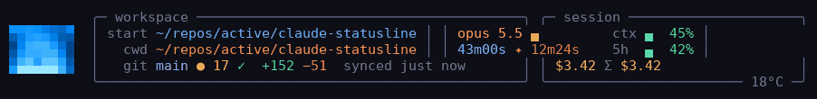

## Install

Needs `jq` (`sudo apt install jq`).

```bash
git clone https://github.com/xhanAI/claude-statusline.git ~/repos/active/claude-statusline
cd ~/repos/active/claude-statusline && ./install.sh
```

Then restart Claude Code. You get the **xhanAI** layout with the green matrix rain in letters.

The installer copies the script to `~/.claude/`, points `statusLine` in `~/.claude/settings.json` at it
(your old settings are saved as `settings.json.bak`), and puts `statusline-demo` and `claude-cost` in `~/.local/bin`.

## Change the animation

The whole look is one word in one file, `~/.claude/statusline-profile`. Write a name into it and the
status line switches within a second. No restart.

**In a normal terminal:**

```bash
echo snake > ~/.claude/statusline-profile
```

**Inside Claude Code**, type the same thing with a `!` in front, and press Enter:

```
! echo snake > ~/.claude/statusline-profile
```

Or just ask Claude: *"switch my status line to snake"*.

### Which names can I use?

Any of these. Each one keeps the same 3-line layout and only swaps the animation on the left:

| | | | |
|:-:|:-:|:-:|:-:|
| 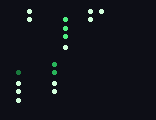<br>`rain` (default) | 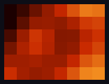<br>`lava` | 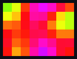<br>`acid` | 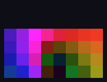<br>`tunnel` |
| 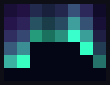<br>`aurora` | 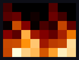<br>`ember` | 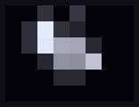<br>`warp` | 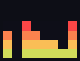<br>`pulse` |
| 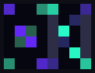<br>`helix` | 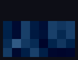<br>`ripple` | 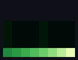<br>`ecg` | 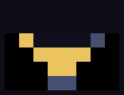<br>`hourglass` |
| 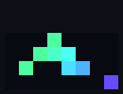<br>`life` | 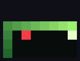<br>`snake` | 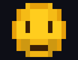<br>`smiley` | 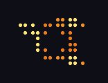<br>`orbit` |
| 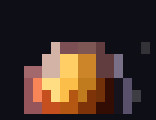<br>`planet` | | | |

These three change the layout instead:

| name | what you get |
|---|---|
| `xhanAI` | the 3-line layout with the art from `~/.claude/statusline-art` (rain if you never set it) |
| `simple` | the plainest bar, 2 lines (`default` also works) |
| `max` | everything there is, 4 lines |

A name that isn't on these lists gives you `simple`. Check what you have with `cat ~/.claude/statusline-profile`.

### Try them before picking

`statusline-demo` plays the animations in your terminal, through every mood. It runs until you press **Ctrl+C**,
so start it in a separate terminal, not inside Claude Code:

```bash
statusline-demo          # every animation, one after the other
statusline-demo snake    # just one
```

### Two smaller knobs

```bash
echo dots    > ~/.claude/statusline-rain   # the rain as braille dots instead of letters
echo letters > ~/.claude/statusline-rain   # back to letters (the default)

echo lava > ~/.claude/statusline-art       # what the plain `xhanAI` profile shows (default: rain)
```

You rarely need the art file: putting the animation's name straight into `statusline-profile` does the same.

### Turn it off

```bash
jq 'del(.statusLine)' ~/.claude/settings.json > /tmp/s.json && mv /tmp/s.json ~/.claude/settings.json
```

Claude Code goes back to its own bar. Run `./install.sh` again to bring this one back.

## Update

```bash
cd ~/repos/active/claude-statusline && git pull && ./install.sh
```

## Other commands

```bash
claude-cost          # money spent per project, most expensive first
claude-cost .        # this project, session by session
claude-cost --book-all   # book every session into ~/.claude/cost-totals.tsv now
tools/make-gifs.py   # (repo only) regenerate the GIFs in docs/
```

## The layouts in detail

The **max** profile:

```
⠃⠶⡄⢈⠃⠰ Session name in a gradient │ ◆ Opus 5.5 effort medium 🧠 │ Tue 21:53 v2.1.296
⏱ 12m11s │ ✦ claude 2m30s 20% busy │ $0.97 $4.75/h │ +120 −30
5h 48% ↻ 2h16m │ 7d 26% ↻ 6d10h │ ctx 8% 78k/1.0M │ ♨ cache 94% warm 58m
user@host ~/repos/x ⎇ main ● 3 ↑1 │ cpu 4% ram 49% 38°C │ 🌦️ 13°C
```

- Session name, model, effort, thinking / fast mode, output style, ticking clock (the colon blinks), Claude Code version.
- Session time, Claude time and % of the session Claude was busy, cost and hourly burn rate, lines added/removed.
- 5h and 7d limits with reset countdowns, context % with tokens, prompt-cache hit rate and how long it stays warm.
- Past 90% of the 5h limit the rain turns red and a blinking `⚠ SLOW DOWN` appears.
- Git branch, dirty file count (or ✔), ahead/behind; CPU load, RAM, CPU temperature; weather from wttr.in (cached 30 min, fetched in the background).

The **xhanAI** profile: minimal, with a small animation on the left (shown here with `lava`):

```
▀▀▀▀▀▀▀▀  ~/repos/active/claude-statusline   adrian-x364   opus 5.5 ▄   🌦️ 13°C
▀▀▀▀▀▀▀▀  ~/repos/active/claude-statusline/docs on main ● 3  ↑ 1  +152 −51 synced 12m ago
▀▀▀▀▀▀▀▀  12m11s ✦ 2m30s   $0.97 Σ $19.52   5h 48% ⏲ ▅   ctx 8%   v2.1.296
```

Line 1 is where the session **started** (blue), line 2 is where it **is now** (orange), one under the other.
After the start dir comes the GitHub account `gh` is logged in as, read from `~/.config/gh/hosts.yml` (no network), so you can
tell your work and home logins apart; each account gets its own colour, and `gh auth switch` shows up within a second.

After the branch: `● 3` changed files, then the remote: `↑ 2` commits not pushed, `↓ 1` commits to pull
(as of the last fetch), `✓` in sync, `no remote` if the branch was never pushed, and `synced 12m ago`,
the last fetch, pull or push. The status line never fetches by itself; run `git fetch` to refresh ↓.

Nothing on line 1 changes during a session, so it can carry the model, effort and weather without anything
shifting. The effort is a one-column level meter that fills from the bottom: `▂` low, `▄` medium, `▅` high, `▇` xhigh, `█` max.
Line 2 is the current path and branch, with the lines changed this session just before `synced`. Line 3 is the
numbers: session time, Claude time, session cost + project total, the 5h limit, context, and the version last.
After the 5h limit, `⏲` and a block in the same style as the effort show the reset charging up like a
battery: `▂` red when the window has just started, through `▄ ▅ ▇`, to `█` green when the reset is close.

### The lava

Each `▀` has its own top (foreground) and bottom (background) colour, so the 8x3 block is an
8x6 true-colour canvas. A plasma of overlapping sine waves flows through it; the mood sets palette and speed:

| mood | looks like | when |
|---|---|---|
| calm | slow orange lava | default |
| working | electric cyan, fast | the transcript was written in the last 4 s (Claude is busy) |
| fire | magenta to white, fastest | working and burning more than $15/h |
| idle | deep blue with a crescent moon, very slow | prompt cache went cold (you've been away) |
| warn | hazard yellow | 5h limit or context at 70%+ |
| alarm | red, pulsing | 5h limit or context at 90%+ |
| clean | green flash for 6 s | the git tree just went from dirty to clean (you committed) |

Run `statusline-demo lava` to watch every mood at 15 fps (`echo lava > ~/.claude/statusline-profile` to use it).
Cost: ~30 ms per refresh (one `jq`, one `awk` for the lava).

### Effects

The same canvas can draw other things, borrowed from the badtrippin experiments (pictures under
[Which names can I use?](#which-names-can-i-use)). The live bar redraws once a second; the GIFs are smoother (12 fps).

| effect | what it is |
|---|---|
| lava | the lava lamp above |
| acid | rainbow plasma: six sine waves run through HSV, like badtrippin's `me.py` |
| tunnel | a spiral tunnel rushing at you |
| aurora | northern lights curtains over a twinkling sky |
| ember | doom-style fire licking up from the bottom |
| warp | stars flying past |
| pulse | an equalizer; bars jump higher the harder Claude works |
| helix | a spinning DNA double helix, on a see-through background (your terminal shows through) |
| ripple | raindrops falling on water |
| ecg | a heartbeat monitor; the pulse races while Claude works |
| hourglass | the sand that has run through = how much of the 5h limit is used |
| life | Conway's game of life, a new world every 30 s |
| snake | a snake touring the canvas, longer as the context fills up |
| orbit | strokes only: a tiny globe outline with three satellites orbiting it, see-through (braille, 16x12 dots) |
| smiley | the classic yellow smiley as pixel art (sextants, 16x9), whose expression is the mood: smiles and blinks (calm), focuses with darting eyes (working), grins and sweats (fire), sleeps with a z (idle), frets (warn), gasps (alarm), beams ^^ (clean) |
| planet | a lit, turning lava planet with an atmosphere, in a see-through sky (sextants, see below) |
| rain | the 3-row matrix rain, in katakana letters or braille dots (default) |

The effects keep their own colours and wear the mood on top: busy makes them faster and brighter,
idle dims and slows them, warn tints amber, alarm pulses red, clean flashes green.
**orbit**, **smiley** and **planet** push the canvas as far as a status line goes. Claude Code refreshes it at most once a second
(`refreshInterval` minimum is 1, events are debounced at 300 ms), so frame rate can't go up; detail can.
`orbit` draws strokes with braille: 2x4 square dots per character, 16x12 in all, and empty dots let the
terminal show through. `planet` and `smiley` fill instead, with Unicode *sextants* (U+1FB00), 2x3 solid pixels per character instead of the 1x2 of `▀`:
16x9 pixels in the same 8x3 space, each one averaged from 4 samples, and each cell gets the two colours
that best fit its six pixels. The planet's surface wears the lava's mood colours.
Sextants are drawn natively by VTE terminals (GNOME Terminal, Ptyxis, Tilix), kitty, WezTerm, foot and
Windows Terminal; elsewhere you need a font with the Legacy Computing block (Cascadia, Iosevka), or you'll see boxes.

`statusline-demo tunnel` shows one effect through every mood; `statusline-demo` alone cycles through all of them.

## Project cost over time

A project is the **repo (or directory) Claude Code was started in**, and the whole session is charged
there, however far it wanders. Start in `~/repos/x`, `cd` into three other repos, and all of it still lands on `~/repos/x`.

- While a session runs, the status line keeps its cost in `~/.claude/cost-ledger/<session-id>`.
- When a session ends (`/exit`, Ctrl+D, `/clear`, logout), a `SessionEnd` hook, `claude-cost --session-end`,
  books it into **`~/.claude/cost-totals.tsv`**: one line per project with its total, number of sessions and last
  active time. `install.sh` adds the hook to `~/.claude/settings.json`.
- Hooks fire on these events, not on what you type: "thanks, bye" doesn't end anything, exiting does.
  If a session never gets its hook (terminal killed, crash), nothing is lost: the Σ and `claude-cost`
  always add the ledgers that are not booked yet, and the next `claude-cost --book-all` books them.
- If a resumed session restarts its counter, it counts on from zero and nothing is lost.

The xhanAI profile shows the start project's all-time total next to the session cost: `$0.97 4.75/h Σ $23.10`.
`claude-cost` lists every project, most expensive first; `claude-cost <dir>` lists that project's sessions.

Only sessions run with this status line are counted. Ledgers from before 2026-10-15 charged money to
whatever directory the session was in at the time; `install.sh` moves all of it to each session's start
directory (read from its transcript).

## How it works

Claude Code pipes a JSON blob (cwd, model, context_window, cost, rate_limits) to the command on stdin; whatever it prints becomes the status bar. The animation is driven by the clock (`date +%s`), one frame per refresh.
